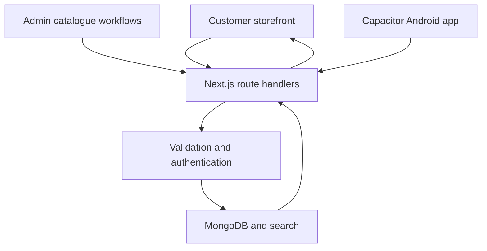

# PMStore

### Pharmacy e-commerce with composition search and catalogue administration

**Status:** Website live; Android application in Google Play testing  
**My role:** Independent full-stack developer; website, backend, administration and Android delivery  
**Source:** Private client repository; this is a public engineering case study

[Live website](https://www.pratigyamedicalstore.com/) · [Portfolio](https://www.dualmindlabs.com/#work) · [Developer profile](../../README.md)

## Overview

PMStore is an e-commerce application for a pharmacy business. It combines a customer storefront with medicine composition search, prescription uploads, catalogue administration and order workflows. The companion Android application uses Capacitor and is in testing rather than public release.

The live website and the Android release have separate delivery statuses. This case study does not treat a testing build as a publicly available Play Store application.

## Problem

A pharmacy catalogue needs more structure than a conventional product listing. Customers may search by ingredient or composition, while staff need to maintain pack sizes, prices, stock and prescription-related information across many catalogue entries.

Pack prices can also be misleading when quantities differ. For example, a ₹30 pack containing 10 units costs ₹3 per unit, while a ₹50 pack containing 20 units costs ₹2.50 per unit. Comparing only the pack price obscures that difference.

## My contribution

- Built and deployed the customer-facing website and administration workflows.
- Implemented medicine composition search and product comparison support.
- Added prescription upload and signed-in prescription-management endpoints.
- Implemented catalogue import/export and product administration.
- Integrated ordering and payment flows.
- Built the Android companion using Capacitor, including a native Google-login integration dependency.

I used AI-assisted development while owning the application architecture, integration, review and delivery work.

## Product capabilities

| Area | Implementation |
| :--- | :--- |
| Discovery | Product catalogue, search and filtering |
| Medicine data | Composition, strength, dosage form, manufacturer and pack size |
| Comparison | Derived composition grouping and unit-price comparison support |
| Prescriptions | Authenticated upload and listing of a user’s prescriptions |
| Commerce | Ordering, payment integration and order administration |
| Operations | Catalogue import/export, stock and product administration |
| Android | Capacitor application in Google Play testing |

## Technical stack

| Layer | Technologies |
| :--- | :--- |
| Web | Next.js, React, TypeScript, Tailwind CSS |
| Server | Next.js route handlers running on Node.js |
| Database | MongoDB with Mongoose |
| Search | MongoDB Atlas Search, with a text-search fallback |
| Authentication | NextAuth and JWT-related integrations |
| Payments | Cashfree integration |
| Android | Capacitor |
| Test tooling | Vitest, with dedicated domain and authentication test modules |

The implementation uses **MongoDB/Mongoose**, not PostgreSQL. The Android package is a **Capacitor** application, not a React Native application.

## Request flow

This is a logical overview of the application, not a deployment or network-security diagram.

## Engineering decisions

### Derive a repeatable composition key

A product’s composition is represented through structured ingredient, strength and form data. The domain module normalises ingredient names, canonicalises supported strength units and sorts ingredient components before building a grouping key. This makes grouping less dependent on the order or spelling in imported catalogue data.

Catalogue grouping supports discovery and price transparency. It is not a clinical determination that two products can safely substitute for one another; medication decisions remain with the appropriate clinician or pharmacist.

### Compare price per unit

The implementation derives unit price from product price and pack size, then uses it when ranking comparison candidates. Stock availability also affects ordering. This is more useful than comparing pack prices across different quantities.

### Maintain derived values before validation

The product model calculates composition keys and unit prices in document validation middleware so required derived fields exist before validation completes. Bulk write paths that bypass document middleware need to calculate the same derived values explicitly.

### Treat prescription access as a server concern

Prescription upload and listing routes require a signed-in user. The listing route filters by the caller’s identity. A disabled button alone would not enforce access to those records.

### Share the web product with Android

The Capacitor application packages the web experience for Android while providing native integration points. This keeps the mobile delivery model aligned with the existing web application. It does not imply that a Play Store release is already complete.

## Verification evidence

The repository contains test modules for composition, pricing, comparisons, expiry handling, import parsing and authentication behaviour. The search route validates query parameters, applies a request limit and delegates to the search implementation.

The existence of those tests is verified; this documentation task did not run the application’s test suite or exercise production checkout. No passing-test count, conversion uplift, search accuracy or performance benchmark is claimed here.

## Current status and limitations

- Website: live at [pratigyamedicalstore.com](https://www.pratigyamedicalstore.com/).
- Android: Google Play testing; public release pending.
- Search and grouping quality depend on accurate catalogue composition and pack-size data.
- Public visitors should not expect access to administrative or prescription-management screens without the appropriate account.
- Client source code and operational data remain private.

## Walkthrough

Visit the public storefront or see the [portfolio](https://www.dualmindlabs.com/#work). A technical walkthrough can cover the catalogue model, composition grouping, unit-price logic, search flow and Android packaging.

Contact [ashwin.hingave123@gmail.com](mailto:ashwin.hingave123@gmail.com). Any source review depends on the relevant permissions.
