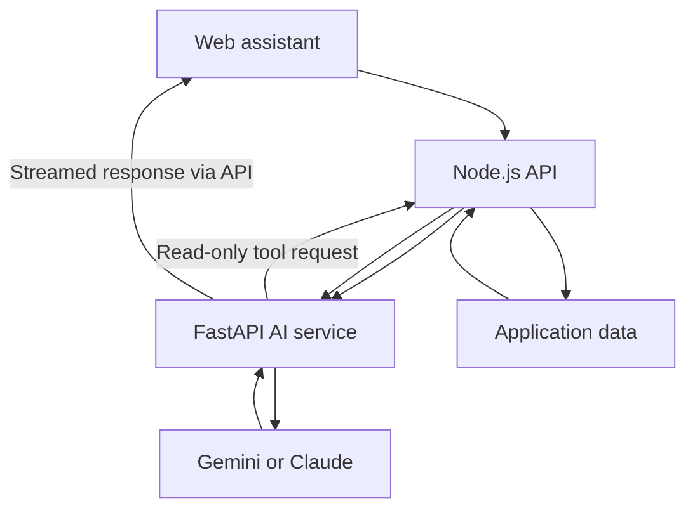

# Smart Shaadi

### Matrimonial platform with a tool-using AI assistant and semantic profile search

**Status:** Pre-launch  
**My role:** Independent full-stack developer; end-to-end implementation  
**Main development period:** May–September 2026  
**Source:** Private client repository; this is a public engineering case study

[Portfolio](https://www.dualmindlabs.com/#work) · [Beta website](https://smartshaadi.co.in/) · [Developer profile](../../README.md)

## Overview

Smart Shaadi brings profile discovery, matching, communication and wedding-related workflows into one platform. I built the application and its AI integration layer, including a streaming assistant that can retrieve relevant application information through an allowlisted set of read-only tools.

The platform is near completion but has not commercially launched. Company registration is pending, and the current environment includes dummy data and service mocks. A beta website is not evidence that payments, identity verification or every external integration is live.

## Problem and product goals

The product needs to support more than profile filters: users also need help understanding their profiles, navigating matches and requests, and working with wedding-related information. An assistant should use the application’s information when answering questions instead of relying only on a language model’s general knowledge.

My implementation combines conventional application workflows with contextual AI assistance and embedding-based profile discovery.

## My contribution

- Translated client requirements into application flows and a monorepo architecture.
- Built profiles, authentication, chat and payment integration code.
- Implemented a streaming, multi-turn assistant with conversational memory and read-only tool calling.
- Added a shared LLM client layer supporting Gemini and Claude.
- Implemented semantic profile re-ranking with 768-dimensional embeddings stored in PostgreSQL/pgvector.
- Connected user-facing AI features and kept backend-only features distinct from the public interface.

I used AI-assisted development extensively while owning the architecture, integration, review and delivery work.

## Implemented AI capabilities

| Capability | Implementation and availability |
| :--- | :--- |
| Conversation coach | LLM-generated suggestions for opening conversations; user-facing |
| Emotional score | Sentiment-based analysis; user-facing |
| Compatibility-risk indicator | Experimental model output with an LLM explanation; user-facing, not a validated prediction of a relationship outcome |
| Family inclination | Family-values compatibility feature; user-facing |
| Matrimony assistant | Streaming, multi-turn assistance with memory and read-only tools; user-facing |
| Semantic match re-ranking | Embedding-based profile similarity using pgvector; user-facing integration, with availability controlled by configuration |
| Attendance prediction | Backend/admin implementation; not a public feature |
| Churn risk | Backend/admin implementation; not a public feature |
| Reputation metric | Response-rate-based metric; backend/admin implementation |
| Marriage readiness and profile optimisation | Backend routes exist; no public UI |

These descriptions concern software implementation and interface availability. Compatibility, readiness and risk indicators are experimental and are not scientifically validated measures of relationship outcomes.

## Architecture

| Layer | Responsibility |
| :--- | :--- |
| Next.js web application | Profiles, discovery, communication and assistant interface |
| Node.js / TypeScript API | Application workflows, authentication and access to user-scoped data |
| Python / FastAPI AI service | Assistant orchestration, provider integration and AI/ML features |
| PostgreSQL / pgvector | Relational data and vector similarity search |
| MongoDB and Redis | Supporting document/history and cache/queue capabilities in the platform |
| Gemini / Claude | Language-model responses behind a common client interface |

The diagram shows the logical assistant request and tool-read flow, not a claim about the currently deployed hosting topology.

## Engineering decisions

### Keep provider differences behind one interface

The LLM client layer translates provider-specific behaviour into a shared calling surface. This keeps assistant and coaching code from depending directly on one provider’s request and response formats. Switching providers still requires configuration, valid credentials and provider-specific verification.

### Use controlled reads for contextual answers

The assistant uses an allowlisted tool catalogue rather than unrestricted database access. The tool layer forwards the caller’s identity and returns bounded results. The active catalogue depends on configuration: knowledge search and semantic-match tools can be enabled separately, so a fixed tool count would become misleading.

### Separate semantic similarity from product eligibility

Embeddings help retrieve similar profiles. Similarity is one input to discovery, not proof of compatibility or a replacement for product-specific preference rules. The vector migration uses 768-dimensional embeddings and an HNSW cosine-similarity index.

### Distinguish service mocks from AI configuration

External-service mocks and AI mock behaviour are separate concerns in the implementation. AI availability depends on the selected provider’s configuration and the explicit AI mock setting. A service-mock flag alone does not prove that every AI response is mocked or live.

## Verification evidence

The private repository includes tests for assistant stream behaviour, conversation history, tool round-trips, provider failures and tool-call budgets. The provider adapter also has a dedicated test module.

This case study documents inspected implementation and existing test coverage areas. It does not claim that the test suite was executed or passed during preparation of this README, and it reports no unmeasured latency, accuracy, scale or conversion figures.

## Current limitations

- Commercial launch and external-provider activation remain separate from code completion.
- A beta environment may show seeded data or mocked service responses.
- Some implemented models and routes are not exposed in the public interface.
- Model-based compatibility and risk indicators are experimental.
- Source code and client-specific operational material remain private.

## Walkthrough

The [portfolio case study](https://www.dualmindlabs.com/#work) provides a public overview. A technical discussion can cover the request flow, provider adapter, tool boundary, vector search and the distinction between implemented code and activated services.

For a walkthrough, contact [ashwin.hingave123@gmail.com](mailto:ashwin.hingave123@gmail.com). Source access is subject to the relevant permissions.
